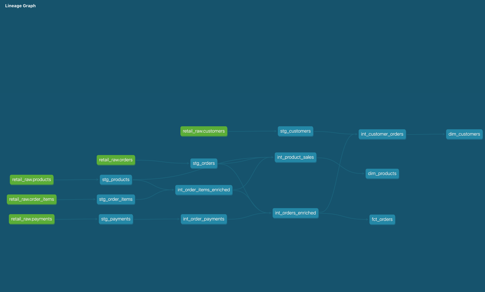

# Retail Shop: dbt + Databricks Pipeline

A dbt project that turns raw online retail data (customers, products, orders, order items and payments) into a clean star schema on Databricks, ready for reporting.

The data is synthetic and deliberately includes realistic data quality issues, so the project can later be used to demonstrate automated testing and documentation.

## Tech stack

- **dbt Core** (dbt-databricks adapter)
- **Databricks** with Unity Catalog, serverless SQL warehouse
- **SQL** (Databricks SQL)

## Lineage



## Project structure

The project follows a layered approach, with each layer built into its own schema in the `retail` catalog.

| Layer | Schema | Materialisation | Purpose |
| --- | --- | --- | --- |
| Sources | `retail.raw` | Delta tables | Raw CSVs loaded as-is |
| Staging | `retail.dev_staging` | Views | One model per source: rename, cast types, standardise values. No joins. |
| Intermediate | `retail.dev_intermediate` | Views | Joins and business logic |
| Marts | `retail.dev_marts` | Tables (fact is incremental) | Final tables for reporting |

### Staging

- `stg_customers`: renames `id` to `customer_id`, tidies name casing and spacing, lowercases emails
- `stg_products`: casts prices to two decimals (`unit_price_gbp`)
- `stg_orders`: lowercases order status, handles blank values safely with `try_cast`
- `stg_order_items`: casts IDs and quantity
- `stg_payments`: lowercases payment method, casts amount and timestamp

### Intermediate

| Model | Grain | What it does |
| --- | --- | --- |
| `int_order_items_enriched` | One row per order item | Joins items to products and calculates line revenue |
| `int_order_payments` | One row per order | Aggregates payments per order, flags split payments |
| `int_orders_enriched` | One row per order | Joins orders to item totals and payment totals; adds days to ship and fully-paid flag |
| `int_customer_orders` | One row per customer | Order counts, first and last order dates, lifetime value, customer segment |
| `int_product_sales` | One row per product | Units sold and revenue from completed orders, price band |

### Marts

| Model | Grain | Description |
| --- | --- | --- |
| `fct_orders` | One row per order | Order value, items, payments, shipping time and status. Incremental. |
| `dim_customers` | One row per customer | Profile, order history, lifetime value and segment (new, returning, loyal) |
| `dim_products` | One row per product | Category, price band, units sold and revenue |

## Key design decisions

**Aggregating before joining to avoid fan-out.** Some orders are paid in two parts (gift card plus card). Joining orders directly to payments would duplicate those orders and inflate revenue, so payments are aggregated to one row per order in `int_order_payments` before the join.

**Business logic lives in intermediate, not marts.** Customer segments, price bands and lifetime value rules are defined once in intermediate models. Marts only select final columns, so each rule has a single source of truth.

**Incremental fact table with a lookback window.** `fct_orders` uses the `merge` strategy on `order_id`. Each run reprocesses orders from the 30 days before the latest order already loaded, so late-arriving orders and status changes (for example, placed to shipped) are picked up and updated rather than duplicated. The window is a dbt variable (`fct_orders_lookback_days`) and can be widened for one-off backfills:

```bash
dbt run -s fct_orders --vars '{fct_orders_lookback_days: 90}'
```

The trade-off is that changes to orders older than the window need a full refresh. With an `updated_at` column in the source, filtering on that would be more precise.

**Business rules applied consistently.** Cancelled orders are excluded from order counts; cancelled and returned orders are excluded from lifetime value and product sales.

**Separate schemas per layer.** Raw data is only ever read through `source()`, and each layer writes to its own schema, so outputs never mix with source tables.

## Data

Raw data lives in `setup/data`:

| Table | Rows |
| --- | --- |
| customers | 200 |
| products | 40 |
| orders | 1,001 |
| order_items | 1,851 |
| payments | 984 |

Orders run from January 2025 to October 2026. Amounts are in GBP.

## How to run

**1. Load the raw data into Databricks**

Upload the CSVs in `setup/data` to a Unity Catalog volume, then run `setup/load_raw.sql` in a Databricks SQL editor. This creates the `retail` catalog, the `raw` schema and the five source tables.

**2. Install dbt**

```bash
python -m venv .venv
source .venv/bin/activate
pip install dbt-databricks
```

**3. Configure your connection** in `~/.dbt/profiles.yml`:

```yaml
retail_shop:
  target: dev
  outputs:
    dev:
      type: databricks
      catalog: retail
      schema: dev
      host: <your-workspace-host>
      http_path: <your-sql-warehouse-http-path>
      token: <your-personal-access-token>
      threads: 4
```

**4. Build the project**

```bash
dbt debug   # check the connection
dbt build   # build all models
```

**5. Explore the docs and lineage**

```bash
dbt docs generate
dbt docs serve
```

## What's next

- Add tests and documentation to all models, using an AI agent that runs on a schedule in GitHub Actions and proposes changes through pull requests
- Track test and documentation coverage over time
